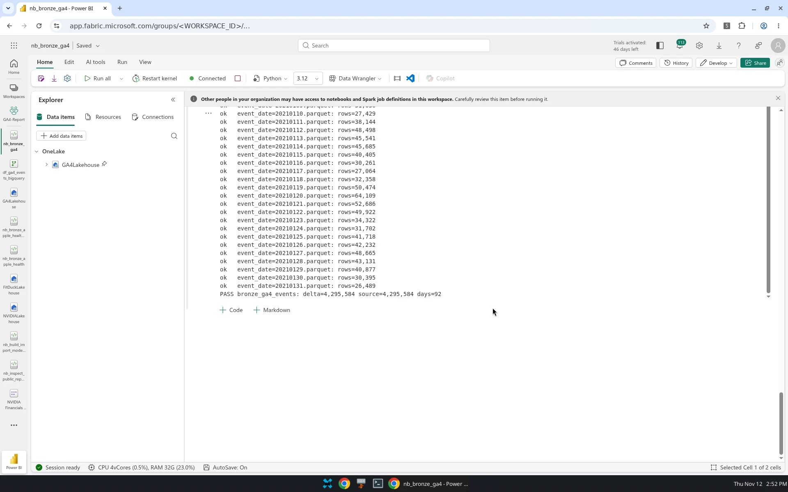
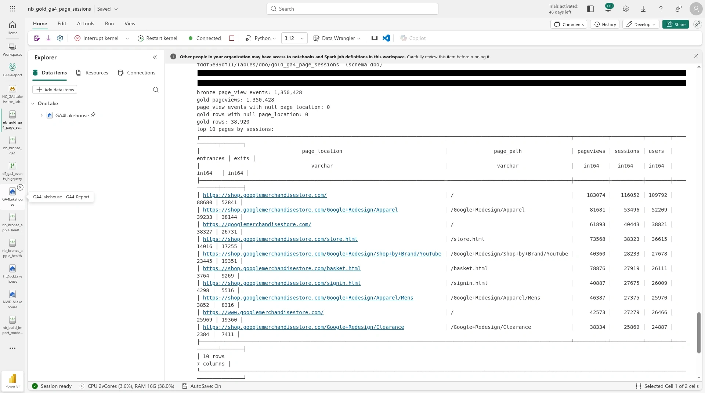
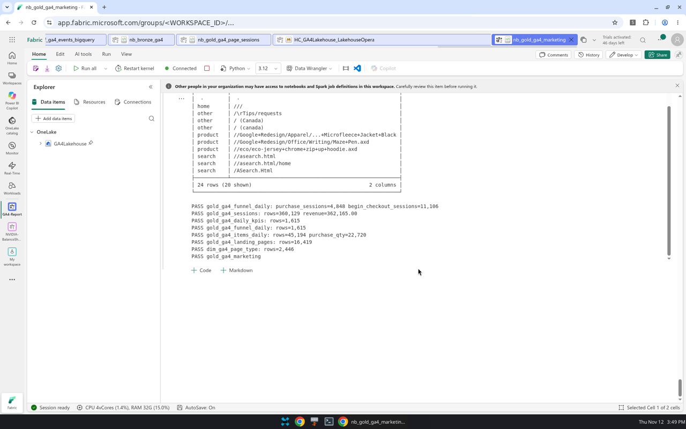
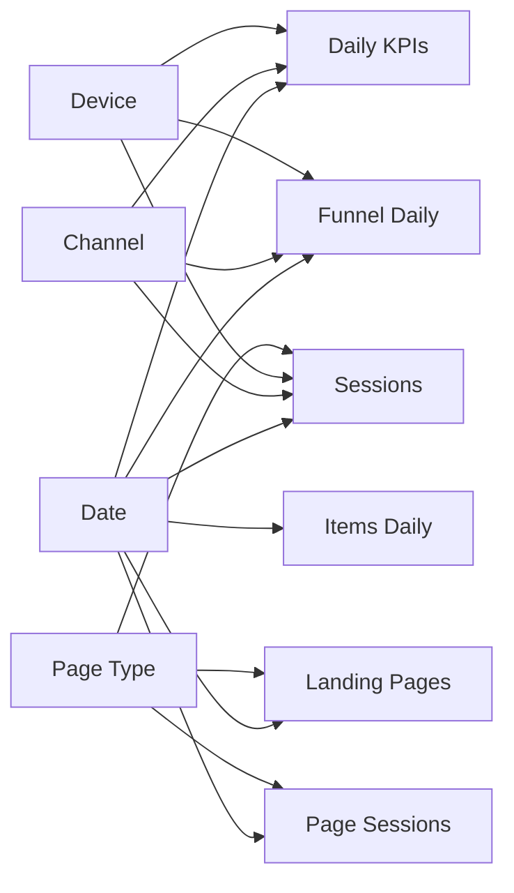

# GA4 — Google Merchandise Store

A Microsoft Fabric portfolio project: the public BigQuery [GA4 obfuscated sample ecommerce](https://console.cloud.google.com/marketplace/product/bigquery-public-data/ga4) dataset (Google Merchandise Store) is exported on a laptop, landed in a OneLake lakehouse, and built into bronze and gold Delta tables for a four-page Power BI report.

**Guiding question:** *Which channels, landing pages and products drive revenue for the Google Merchandise Store?*

> **Status: Bronze + gold tables ready. Semantic model notebook ready.** Import `nb_semantic_model_ga4.ipynb` into Fabric and run it after `nb_gold_ga4_dim_date`. The four report pages are not built yet.

## The story in four pages

| Page | Question | What it will show |
|---|---|---|
| **1 · Executive overview** | Is traffic and revenue up or down, and which channel drove the change? | KPI cards with period-over-period change, a trend line, and revenue by channel |
| **2 · Acquisition** | Which sources bring revenue, not just sessions? | Channel to source/medium matrix with sessions, conversion rate, revenue and revenue per session, plus a device by geo split |
| **3 · Content & landing pages** | Which landing pages earn, and which only attract sessions? | Top-pages table with engagement, conversion rate and revenue per session, with a page-type slicer |
| **4 · Funnel & products** | Where do people drop, and which products convert? | Funnel drop-offs by device, and product and category performance |

## Architecture

```
BigQuery public dataset
bigquery-public-data.ga4_obfuscated_sample_ecommerce
  events_* tables (Storage Read API, list_rows().to_arrow())
  gcloud ADC on the laptop; billing/quota project required
        │
        ▼
scripts/export_ga4.py
  one snappy parquet per day
        │
        ▼
scripts/upload.py
  InteractiveBrowserCredential → OneLake
  Files/raw/ga4/ingest_date=…/events/event_date=YYYYMMDD.parquet
        │
        ▼
nb_bronze_ga4.ipynb   (Fabric Python 3.12, deltalake)
  dbo.bronze_ga4_events   partitioned by event_date
        │
        ├──► nb_gold_ga4_page_sessions.ipynb
        │      dbo.gold_ga4_page_sessions
        │
        └──► nb_gold_ga4_marketing.ipynb
               dbo.gold_ga4_sessions
               dbo.gold_ga4_daily_kpis
               dbo.gold_ga4_funnel_daily
               dbo.gold_ga4_items_daily
               dbo.gold_ga4_landing_pages
               dbo.dim_ga4_page_type
        │
        ▼
nb_gold_ga4_dim_date.ipynb
  dbo.dim_ga4_date
        │
        ▼
nb_semantic_model_ga4.ipynb   (Fabric Python 3.12, semantic-link / sempy_labs)
  dbo.dim_ga4_channel
  dbo.dim_ga4_device
  Direct Lake model **GA4 Ecommerce**
        │
        ▼
4-page Power BI report  (not started)
```

Python notebooks write Delta through the OneLake `abfss://` endpoint with a storage bearer token (the FUSE mount cannot do the atomic rename Delta needs). Workspace and lakehouse IDs are taken from the attached default lakehouse at runtime — they are not hardcoded.

## Table catalog

Verified after the Fabric gold runs, for `ingest_date=2026-11-12`. Schema `dbo` in **GA4Lakehouse** (workspace **GA4-Report**).

| Table | Grain | Verified |
|---|---|---|
| `bronze_ga4_events` | one event | 4,295,584 rows, 92 days, 2020-11-01 to 2021-01-31 |
| `gold_ga4_page_sessions` | date × URL | 38,920 rows, 1,350,428 pageviews matching bronze |
| `gold_ga4_sessions` | one session | 360,129 sessions, $362,165 revenue |
| `gold_ga4_daily_kpis` | date × channel × device | 1,615 rows |
| `gold_ga4_funnel_daily` | same grain | 1,615 rows; 11,106 begin_checkout sessions and 4,848 purchase sessions |
| `gold_ga4_items_daily` | date × item | 45,194 rows, 22,720 units |
| `gold_ga4_landing_pages` | date × landing URL | 16,419 rows, with revenue per session |
| `dim_ga4_page_type` | page path | 2,446 paths labelled home, category, product, cart, checkout, search, account, or other |
| `dim_ga4_date` | one row per day | 92 days |
| `dim_ga4_channel` | one channel group | distinct `channel_group` from the session-grained facts; written by `nb_semantic_model_ga4` |
| `dim_ga4_device` | one device category | distinct `device_category` from the session-grained facts; written by `nb_semantic_model_ga4` |

`gold_ga4_page_sessions` is left unchanged by the marketing notebook; landing-page revenue lives in `gold_ga4_landing_pages`.







## Semantic model

`nb_semantic_model_ga4.ipynb` creates the Direct Lake on OneLake model **GA4 Ecommerce** (Python 3.12, not Spark). It writes the two conformed dims, rebuilds `dim_ga4_page_type` only when a fact path is missing, then generates the model with `overwrite=False`. If a model with that exact name already exists, generation is skipped and relationships and measures are updated in place via TOM. `bronze_ga4_events` is not in the model. No report is created.

All relationships are single-direction, many-to-one from the fact to the dimension. `Date[date]` is the marked date table. `month_name` is sorted by `month_num` and `day_name` by `day_of_week_num`.



| From (many) | Column | To (one) | Column |
|---|---|---|---|
| Sessions, Daily KPIs, Funnel Daily, Landing Pages | `session_date` | Date | `date` |
| Items Daily, Page Sessions | `event_date` | Date | `date` |
| Sessions, Daily KPIs, Funnel Daily | `channel_group` | Channel | `channel_group` |
| Sessions, Daily KPIs, Funnel Daily | `device_category` | Device | `device_category` |
| Sessions, Landing Pages | `landing_page_path` | Page Type | `page_path` |
| Page Sessions | `page_path` | Page Type | `page_path` |

Base measures live on a calculated `_Measures` table and are computed with `DIVIDE` from sums or distinct counts — never by averaging a pre-computed rate column. Users is `DISTINCTCOUNT` of `user_pseudo_id` on Sessions. Display folders follow the four report pages.

| Folder | Measures |
|---|---|
| Pages\01 Overview | Sessions, Users, New Users, Engaged Sessions, Engagement Rate, Purchases, Revenue, Conversion Rate, AOV, Revenue per Session, Revenue Share of Top Channel, Pageviews |
| Pages\02 Acquisition | Sessions, Users, New Users, Engaged Sessions, Engagement Rate, Purchases, Revenue, Conversion Rate, AOV, Revenue per Session, Revenue Share of Top Channel |
| Pages\03 Content | Sessions, Users, Engaged Sessions, Engagement Rate, Pageviews, Revenue, Conversion Rate, Revenue per Session |
| Pages\04 Funnel & Products | View Item / Add to Cart / Begin Checkout / Add Payment Info / Purchase Sessions, the step-to-step rates, View Item to Purchase Rate, Item Views, Add to Carts, Item Revenue, Add-to-Cart Rate, plus Purchases, Revenue, Conversion Rate |

After a full refresh the notebook runs a DAX query and checks these verified gold totals: Sessions = 360,129, Revenue = 362,165, Pageviews = 1,350,428. It prints PASS or FAIL.

## Data notes

- **Session attribution.** The export's `traffic_source` field is the user's first-touch source, not the session source. `source`, `medium`, and `campaign` are taken from `event_params` on the first event in the session that has them. If a session has none, the notebook falls back to `traffic_source` and records the choice in `attribution_source` (`event_params` or `traffic_source`).
- **Obfuscation.** The public sample is obfuscated. Values such as `<Other>` and `(data deleted)` appear in some fields and should be treated as dataset noise.
- **Holiday window.** The 92 days run from 1 Nov 2020 to 31 Jan 2021 and cover Black Friday and Christmas, so the series should not be read as a normal trend.
- **UI vs export.** GA4 UI numbers and the BigQuery export will not match exactly, because of thresholding, modeled data, and approximate distinct counts in the UI.
- **Item lists.** `view_item` and `add_to_cart` often carry a related-item list (~12 rows, `quantity` null). Those lists are not counted. A view or add is kept when `quantity` is set, or when the event has exactly one item. `begin_checkout` and `purchase` arrays are fully unnested. `view_item` events with an empty `items` array have no `item_id` and are omitted.
- **Users vs sessions.** Users and sessions do not add up across dimensions. Session IDs are built from `user_pseudo_id` plus `ga_session_id`.

## Repository layout

```
scripts/         export_ga4.py (BigQuery Storage Read API) and upload.py (OneLake)
notebooks/       Fabric Python 3.12 bronze, gold, and semantic model notebooks (outputs cleared)
docs/img/        lakehouse and notebook screenshots
requirements.txt local script dependencies
.env.example     placeholder IDs only — real values stay local
```

## Tech

Microsoft Fabric (Lakehouse, Notebooks, OneLake, Direct Lake) · Delta Lake (`deltalake`) · DuckDB · Python 3.12 · PyArrow · Semantic Link (`sempy_labs`) · BigQuery Storage Read API · Azure Identity · (next) Power BI report

## How to run

1. Copy `.env.example` to `.env` and fill in your GCP billing/quota project and Fabric IDs. Do not commit `.env`.

   ```bash
   python -m venv .venv
   source .venv/bin/activate
   pip install -r requirements.txt
   ```

2. Authenticate to Google Cloud (Application Default Credentials) and export:

   ```bash
   gcloud auth application-default login
   python scripts/export_ga4.py --project YOUR_GCP_PROJECT
   ```

   Writes one snappy parquet per day under `~/fabric-sync/ga4/staging/Files/raw/ga4/ingest_date=<today>/events/`. Override the date with `--ingest-date`. The billing/quota project can also come from `GCP_PROJECT` in `.env`.

3. Upload to OneLake (interactive browser login):

   ```bash
   python scripts/upload.py --workspace YOUR_WORKSPACE_ID --lakehouse YOUR_LAKEHOUSE_ID
   ```

   Targets the **GA4-Report** workspace and **GA4Lakehouse** lakehouse. IDs can also come from `FABRIC_WORKSPACE_ID` and `FABRIC_LAKEHOUSE_ID` in `.env`.

4. In Fabric, import the notebooks under `notebooks/` into **GA4-Report**, attach **GA4Lakehouse** (Add data items → From OneLake catalog), set the kernel to **Python 3.12**, and Run all in this order: `nb_bronze_ga4` → `nb_gold_ga4_page_sessions` → `nb_gold_ga4_marketing` → `nb_gold_ga4_dim_date` → `nb_semantic_model_ga4`. Each gold notebook must print `PASS`. The semantic model notebook needs XMLA read/write on the capacity and must print `OVERALL: PASS` for the Sessions / Revenue / Pageviews check.

Bronze looks for `Files/raw/ga4/ingest_date=2026-11-12/events/`. Change `INGEST_DATE` in the notebook if you export on another day.

## Data & attribution

- Source: [BigQuery public dataset `bigquery-public-data.ga4_obfuscated_sample_ecommerce`](https://console.cloud.google.com/marketplace/product/bigquery-public-data/ga4) (Google Merchandise Store, obfuscated GA4 export).
- This repository does not redistribute the event files; you export them yourself and land them in OneLake.
- Not affiliated with Google. Figures are derived from the obfuscated sample and will not match a live GA4 property.

[DataPat.ai](https://data-pat-ai.netlify.app/) · [LinkedIn](https://www.linkedin.com/in/patriciorioscanepa)
